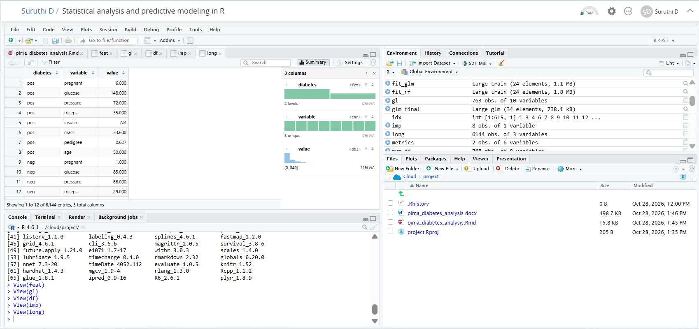

# Statistical Analysis and Predictive Modeling using R

 Project: Statistical analysis and classification modeling in R
using the Pima Indians Diabetes dataset.

## Objective
Choose a public dataset, perform hypothesis testing, build and evaluate a
predictive model with cross-validation, and document the full process.

## Dataset
`PimaIndiansDiabetes2` from the `mlbench` R package (768 patients, 8 clinical
predictors, binary outcome: diabetes pos / neg). It contains missing values
(insulin 48.7%, triceps 29.6%), handled with median imputation inside the
cross-validation folds to avoid data leakage.

## Methods
- Exploratory analysis: summary statistics, distributions, missing-value profile
- Normality checks (Shapiro-Wilk, Q-Q plots) and Spearman correlations
- Hypothesis tests: Welch t-test, Wilcoxon rank-sum (Bonferroni corrected),
  chi-square (age group vs diabetes), variance test
- Models: logistic regression and random forest (caret), 80/20 stratified
  split, 10-fold cross-validation
- Evaluation: confusion matrix, accuracy, sensitivity, specificity, F1,
  ROC/AUC, threshold tuning
- Diagnostics: odds ratios, VIF, residual plots, Cook's distance,
  variable importance

## Key results
| Metric (test set) | Logistic regression | Random forest |
|---|---|---|
| Accuracy | 0.804 | 0.810 |
| Sensitivity | 0.604 | 0.660 |
| Specificity | 0.910 | 0.890 |
| AUC | 0.890 | 0.886 |

- Majority-class baseline accuracy: 0.654
- Glucose was the strongest predictor (odds ratio 3.14 per SD), followed by
  BMI, number of pregnancies and the pedigree function.
- Lowering the threshold to about 0.27 raised sensitivity from 0.60 to 0.89
  (specificity 0.75).

## Files
- `pima_diabetes_analysis.Rmd`: full R Markdown source code
- `Statistical_Analysis_Predictive_Modeling.docx`: final report with code, outputs and plots (open to view)
-  `Statistical_Analysis_Predictive_Modeling.pdf`: final report for viewing without download
 ## Screenshot

Fig: Project running in RStudio on Posit Cloud, showing the Rmd file, data objects and knitted
output

## How to run
1. Open the `.Rmd` in RStudio or Posit Cloud.
2. Install the packages: mlbench, ggplot2, dplyr, tidyr, caret, pROC,
   corrplot, randomForest.
3. Run the chunks in order, or click Knit to Word.

## Tools
R, RStudio / Posit Cloud, caret, pROC, ggplot2
